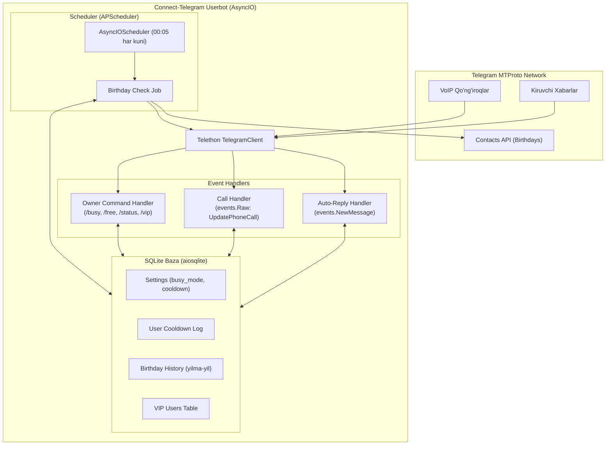

# 🤖 Telegram Shaxsiy Avtomatlashtirish Loyihasi — Telethon Userbot

## 1. Maqsad va Vazifalar
Ushbu loyiha shaxsiy Telegram akkauntingizni (`Userbot`) **Telethon** yordamida professional darajada avtomatlashtirish uchun mo'ljallangan. 

Asosiy talablar va amalga oshiriladigan vazifalar:
1. **Auto-Reply (Bandlik xabari)**: Sizga shaxsiy xat kelganda, "Hozirda muhim loyihalar ustida ishlayapman..." deb chiroyli va rasmiy xabar qaytarish (takroriy xabarlarda spam bo'lmasligi uchun Cooldown mexanizmi bilan).
2. **Qo'ng'iroqlar boshqaruvi (Call Management)**:
   - **O'tkazib yuborilgan qo'ng'iroq**: Agar siz qo'ng'iroqni ko'tara olmasangiz, qo'ng'iroq qilgan odamga avtomatik tushuntirish va kechirim xabari yuboriladi.
   - **Suhbat yakunlanganda**: Suhbat tugagandan so'ng, "Siz bilan gaplashganimizdan juda xursandman..." degan samimiy minnatdorchilik xabari yuboriladi.
3. **Tug'ilgan kun tabriklari (Birthday Greetings)**: Har kuni ertalab kontaktlar ro'yxatidagi tug'ilgan kunlarni avtomatik aniqlab, ularning nomiga moslashtirilgan chiroyli tabrik xabari yuborish.
4. **Boshqaruv buyruqlari**: O'zingizning "Saved Messages" (Saqlangan xabarlar) chatidan turib tizimni boshqarish (`/busy`, `/free`, `/status`, `/vip`, `/birthdays`).

---

## 2. Texnologik Tanlov: Celery vs APScheduler

Foydalanuvchi Celery haqida so'ragan edi. Quyida bu ikki texnologiyaning ushbu vazifa uchun solishtirmasi keltirilgan:

| Mezon | APScheduler (`AsyncIOScheduler`) ⭐ (Tavsiya) | Celery (`Celery Beat` + Worker) |
| :--- | :--- | :--- |
| **Integratsiya** | Telethon'ning `asyncio` event loop'i bilan bir xil jarayonda tabiiy ishlaydi | Alohida sinxron jarayonlarda ishlaydi |
| **TelegramClient bilan ishlash** | Bitta `client` obyekti to'g'ridan-to'g'ri ishlatiladi (`await client.send_message`) | Telethon session fayli SQLite bo'lgani sabab alohida worker'larda lock xatosi kelib chiqadi |
| **Qo'shimcha infratuzilma** | Hech narsa kerak emas (0 ta tashqi servis) | Redis yoki RabbitMQ serveri o'rnatilishi va doim ishlab turishi shart |
| **Resurs sarfi** | Juda kam (5-10 MB RAM) | Yuqori (Redis + Celery Worker + Celery Beat: ~100-150 MB RAM) |

> [!NOTE]
> **Xulosa**: Mazkur userbot uchun **APScheduler** eng to'g'ri, xavfsiz va yengil yechim hisoblanadi. Agar kelajakda minglab og'ir vazifalar (masalan, video renderlash yoki AI generatsiya) qo'shilsa, Celery'ga o'tkazish mumkin. Hozirgi holatda APScheduler tanlandi.

---

## 3. Tizim Arxitekturasi



---

## 4. Loyiha Tuzilmasi

```
connect_telegram/
├── pyproject.toml                     # Loyiha sozlamalari va dependencies (Telethon, APScheduler, aiosqlite, dotenv)
├── .env.example                       # API_ID va sozlamalar namunasi
├── .env                               # Shaxsiy credentials (gitignore qilinadi)
├── .gitignore                         # .session, .env, *.db va kesh fayllar
├── README.md                          # Loyihani ishga tushirish bo'yicha to'liq qo'llanma
└── src/
    └── connect_telegram/
        ├── __init__.py                # Paket eksportlari
        ├── main.py                    # Dastur entrypoint (ishga tushirish, signal handling)
        ├── config.py                  # .env va default parametrlarni tekshirib yuklash
        ├── client.py                  # Telethon TelegramClient yaratish va sozlash
        ├── database.py                # aiosqlite orqali ma'lumotlar bazasi (CRUD)
        ├── templates.py               # Chiroyli va samimiy o'zbekcha shablonlar
        ├── handlers/
        │   ├── __init__.py
        │   ├── auto_reply.py          # Kiruvchi xabarlar uchun aqlli avto-javob
        │   ├── call_handler.py        # O'tkazib yuborilgan va yakunlangan qo'ng'iroqlar
        │   └── commands.py            # Saqlangan xabarlar orqali userbotni boshqarish
        └── scheduler/
            ├── __init__.py
            └── birthday.py            # Tug'ilgan kunlarni tekshirish va tabriklash
```

---

## 5. Komponentlar bo'yicha Aniq Implementatsiya

### A. Dependensiyalar (`pyproject.toml`)
#### [MODIFY] pyproject.toml
```toml
[project]
name = "connect-telegram"
version = "0.1.0"
description = "Personal Telegram automation userbot using Telethon"
readme = "README.md"
authors = [
    { name = "shokhjahon0126", email = "mardonovshohjahon2006@gmail.com" }
]
requires-python = ">=3.12"
dependencies = [
    "telethon>=1.37.0",
    "python-dotenv>=1.0.1",
    "apscheduler>=3.10.4",
    "aiosqlite>=0.20.0",
    "pytz>=2024.1",
]

[project.scripts]
connect-telegram = "connect_telegram.main:main"

[build-system]
requires = ["uv_build>=0.12.22,<0.13.0"]
build-backend = "uv_build"
```

---

### B. Konfiguratsiya (`config.py` va `.env.example`)
#### [NEW] .env.example
```env
# Telegram API ma'lumotlari (https://my.telegram.org saytidan olinadi)
API_ID=12345678
API_HASH=abcdef0123456789abcdef0123456789
SESSION_NAME=data/user_session

# Foydalanuvchi ismi (shablonlarda ko'rsatiladi)
OWNER_NAME=Shohjahon

# Auto-Reply sozlamalari
AUTO_REPLY_ENABLED=true
AUTO_REPLY_COOLDOWN_MINUTES=30

# Qo'ng'iroq xabarlari sozlamalari
CALL_HANDLER_ENABLED=true
MISSED_CALL_REPLY=true
POST_CALL_REPLY=true
CALL_COOLDOWN_MINUTES=15

# Tug'ilgan kun scheduler sozlamalari
BIRTHDAY_CHECK_HOUR=0
BIRTHDAY_CHECK_MINUTE=5
TIMEZONE=Asia/Tashkent

# Ma'lumotlar bazasi
DATABASE_PATH=data/userbot.db
```

#### [NEW] src/connect_telegram/config.py
- Barcha atrof-muhit o'zgaruvchilarini yuklash va turlarini tekshirish (casting).
- Ma'lumotlar papkasi (`data/`) mavjud bo'lmasa, avtomatik yaratish.

---

### C. Ma'lumotlar Bazasi (`database.py`)
#### [NEW] src/connect_telegram/database.py
SQLite quyidagi jadvallarni o'z ichiga oladi:
1. `settings`: Kalit-qiymat shaklidagi global sozlamalar (`is_busy`, `auto_reply_active`).
2. `message_logs`: Kimga qachon avto-javob qaytarilgani (cooldown tekshirish uchun).
3. `call_logs`: Qo'ng'iroqlar tarixi va oxirgi javob vaqtlari.
4. `birthday_history`: Yil davomida takroran tabriklamaslik uchun (`user_id`, `year`).
5. `vip_users`: Avto-javobdan mustasno bo'lgan shaxslar ro'yxati.

Asosiy metodlar:
- `can_send_auto_reply(user_id, cooldown_minutes) -> bool`
- `can_send_call_reply(user_id, cooldown_minutes) -> bool`
- `is_vip(user_id) -> bool`
- `is_birthday_already_sent(user_id, year) -> bool`
- `get_stats() -> dict` (Bugungi va jami statistika)

---

### D. Xabar Shablonlari (`templates.py`)
#### [NEW] src/connect_telegram/templates.py
Shablonlar samimiy, o'zbek tilida va estetik emoji belgilar bilan tuziladi:

1. **Auto-Reply (Bandlik xabari)**:
```
🔔 Assalomu alaykum!

Hozirda muhim loyihalar ustida ishlayapman va xabarlarga darhol javob bera olmayapman.

📋 Hozirgi bandlik sababi:
• Dasturlash va tizim loyihalari jarayoni
• Shoshilinch texnik vazifalar

⏰ Bo'shashim bilan sizga albatta javob yozaman!
📞 Agar kechiktirib bo'lmaydigan shoshilinch masala bo'lsa, qo'ng'iroq qilishingiz mumkin.

Hurmat bilan,
{owner_name} 🙏
```

2. **O'tkazib yuborilgan qo'ng'iroq xabari**:
```
📞 Qo'ng'irog'ingizga javob bera olmadim

Assalomu alaykum! Qo'ng'iroq qilganingiz uchun rahmat. 
Afsuski, hozir qo'ng'iroqni ko'tara olmadim (muhim ish jarayonidaman).

💬 Iltimos, maqsadingizni qisqacha xabar qilib qoldiring. 
Vaqt bo'lishi bilanoq sizga o'zim qayta aloqaga chiqaman!

Keltirilgan noqulaylik uchun uzr so'rayman. 🙏
```

3. **Muvaffaqiyatli suhbatdan keyingi minnatdorchilik xabari**:
```
✨ Suhbat uchun rahmat!

Siz bilan gaplashganimizdan juda xursand bo'ldim! 😊

Muloqotimiz foydali va maroqli bo'ldi deb umid qilaman. 
Doimo aloqada bo'laylik! Qo'shimcha fikr yoki savollar bo'lsa, bemalol yozishingiz mumkin.

Kuningiz xayrli va unumli o'tsin! ☀️

Hurmat bilan,
{owner_name} 🤝
```

4. **Tug'ilgan kun tabriklari (3 xil variantda tasodifiy tanlanadi)**:
- Variant 1 (Samimiy va dildan tilaklar)
- Variant 2 (Karyera va muvaffaqiyat tilaklari)
- Variant 3 (Yorqin va do'stona bayram kayfiyati)

---

### E. VoIP Qo'ng'iroqlarni Qayta Ishlash (`call_handler.py`)
#### [NEW] src/connect_telegram/handlers/call_handler.py
Telegram'da qo'ng'iroqlar `UpdatePhoneCall` ko'rinishida keladi:
- `PhoneCallRequested`: Yangi qo'ng'iroq boshlanganda `admin_id` (qo'ng'iroq qilgan shaxs) eslab qolinadi.
- `PhoneCallAccepted`: Agar siz yoki qarshi tomon go'shakni ko'tarsa, `is_connected = True` belgilanadi.
- `PhoneCallDiscarded`: Qo'ng'iroq yakunlanganda:
  - Agar go'shak ko'tarilmagan bo'lsa yoki sabab `PhoneCallDiscardReasonMissed` / `PhoneCallDiscardReasonBusy` bo'lsa ➡️ **O'tkazib yuborilgan qo'ng'iroq xabari** yuboriladi.
  - Agar gaplashilgan bo'lsa (`is_connected == True` va `PhoneCallDiscardReasonHangup`) ➡️ **Minnatdorchilik xabari** yuboriladi.
  - Cooldown: Ketma-ket qo'ng'iroq qilganda bitta odamga qayta-qayta xabar bormasligi ta'minlanadi.

---

### F. Avto-Javob Qayta Ishlash (`auto_reply.py`)
#### [NEW] src/connect_telegram/handlers/auto_reply.py
Qoidalar:
- Faqat shaxsiy chatlar (`event.is_private`)
- O'zingiz yozgan xabarlar inobatga olinmaydi (`event.out == False`)
- Botlar va Telegram xizmat xabarlari filtrlanadi
- VIP ro'yxatdagilarga avto-javob bormaydi
- Agar `is_busy` o'chiq bo'lsa, avto-javob bormaydi
- Cooldown (masalan, 30 daqiqa): oxirgi marta xat yozgan odamga faqat 1 marta javob qaytariladi.

---

### G. Boshqaruv Buyruqlari (`commands.py`)
#### [NEW] src/connect_telegram/handlers/commands.py
Faqat o'zingiz yozganda ishlaydigan xizmat buyruqlari:
- `.busy` yoki `/busy` — Bandlik rejimini yoqish (avto-javob ishlaydi).
- `.free` yoki `/free` — Erkin rejimni yoqish (avto-javob to'xtatiladi).
- `.status` — Tizim holati (bandlik, scheduler, bugungi xabarlar statistikasi).
- `.vip @username` yoki `.vip add <id>` — VIP ro'yxatiga qo'shish.
- `.vip list` — VIP foydalanuvchilar ro'yxati.
- `.check_birthdays` — Tug'ilgan kun tekshiruvini darhol sinash.

---

### H. Tug'ilgan Kun Scheduleri (`scheduler/birthday.py`)
#### [NEW] src/connect_telegram/scheduler/birthday.py
- Har kuni soat 00:05 da ishlaydi (`Tashkent` vaqti bilan).
- `client(functions.contacts.GetBirthdaysRequest())` orqali bugun tug'ilgan kun bo'lgan kontaktlar olinadi.
- Bugungi sanaga to'g'ri kelgan va joriy yilda hali tabriklanmagan shaxslarga chiroyli tabrik xabari jo'natiladi.
- Telegram spam himoyasi (FloodWait) buzilmasligi uchun har bir tabrik orasida 5-10 soniya pauza qilinadi.

---

### I. Entrypoint va Client (`client.py` va `main.py`)
#### [NEW] src/connect_telegram/client.py
Telethon `TelegramClient` obyektini `.session` fayli bilan yaratish.

#### [NEW] src/connect_telegram/main.py
- Barcha tizimlarni (DB, Scheduler, Event Handlers) birga ishga tushirish.
- Graceful shutdown (`SIGINT`, `SIGTERM` signallarini to'g'ri qabul qilish).

---

## 6. Foydalanuvchi Ko'rib Chiqishi Kerak Bo'lgan Jihatlar (User Review)

> [!IMPORTANT]
> **Telegram API Credentials**: Dasturni ishga tushirish uchun sizga `API_ID` va `API_HASH` kerak bo'ladi. Ularni [my.telegram.org](https://my.telegram.org) saytiga telefon raqamingiz orqali kirib, **API development tools** bo'limidan 2 daqiqada olishingiz mumkin.

> [!NOTE]
> **Birinchi kirish**: Birinchi marta `uv run connect-telegram` qilganingizda terminalda Telegram tasdiqlash kodi so'raladi (agar 2FA parol bo'lsa, parol ham). Shundan so'ng sessiya fayli saqlanib qoladi va keyingi safar kod so'ramaydi.

---

## 7. Tekshirish va Sinov Rejasi (Verification Plan)

### Avtomatlashtirilgan tekshiruv:
1. Loyiha bog'liqliklarini o'rnatish: `uv sync`
2. Python sintaksisi va modullar importini tekshirish: `uv run python -m py_compile src/connect_telegram/*.py`
3. Ma'lumotlar bazasi initsializatsiyasi va jadvallar yaratilishini tekshirish skripti.

### Qo'lda tekshirish qadamlari:
1. **Auto-reply testi**: Boshqa akkauntdan o'zingizga salom yozing ➡️ Loyiha ustida ishlayotganingiz haqidagi shablon kelishini ko'ring.
2. **Cooldown testi**: 5 daqiqadan so'ng yana yozing ➡️ Ikkinchi marta takroriy xabar bormasligini tekshiring.
3. **Qo'ng'iroq testi**: O'zingizga qo'ng'iroq qiling va ko'tarmang ➡️ O'tkazib yuborilgan qo'ng'iroq xabari kelishini tekshiring.
4. **Suhbat yakuni testi**: Qo'ng'iroq qilib, go'shakni ko'taring va 5 soniyadan keyin o'chiring ➡️ "Siz bilan gaplashganimizdan xursandman" xabari kelishini tekshiring.
5. **Buyruqlar testi**: O'zingizning "Saved Messages" chatiga `.status` yozing ➡️ Barcha statistika chiqishini tekshiring.
